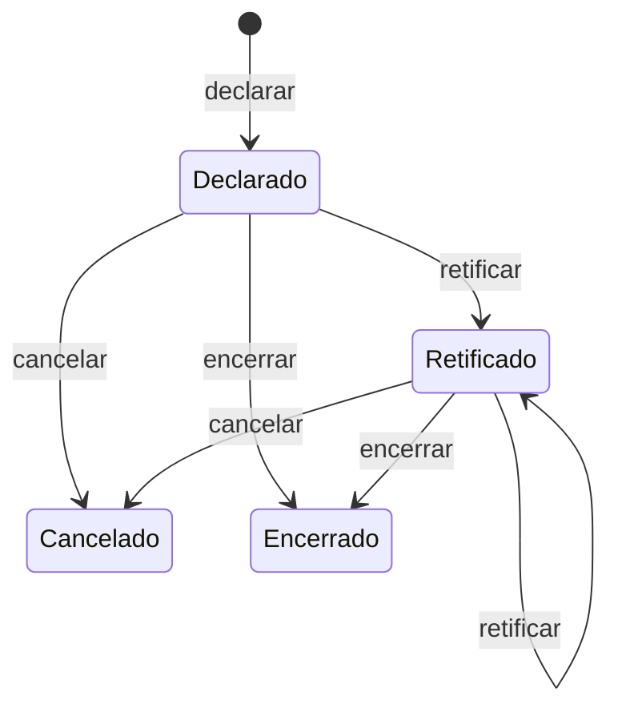

# Módulo CIOT (ANTT, Pagamento Eletrônico de Frete): especificação de integração e desenho

Fontes: contrato de serviço da ANTT "Pagamento Eletrônico de Frete, Serviços PEF, Versão Piso Mínimo de Frete", v1.1 de
13/05/2026 (66 páginas; `https://www.gov.br/antt/pt-br/assuntos/cargas/ciot-para-todos-1/dcs_pef_v1-1.pdf`), e a
experiência prática de uma integração em produção com esse webservice. Cada afirmação traz a origem:

- **[PDF]** consta no contrato da ANTT.
- **[prática]** convenção observada na integração real, que o PDF não define; **validar em homologação** antes de depender dela.
- **[proposta]** decisão de desenho do ctech-dfe.

## 1. Escopo

Declarar, retificar, cancelar e encerrar a operação de transporte rodoviário de cargas (CIOT) na ANTT, consultar situação
de transportador e frota, e ligar o CIOT ao MDF-e (`infCIOT`). A regra F113 do MOC do MDF-e (NT 2026.001, produção em
23/11/2026) passa a exigir CIOT em MDF-e de TAC e de `tpEmit` 1 e 3.

## 2. O webservice

- **Protocolo [PDF]:** REST com JSON, síncrono. POST nos serviços com corpo, GET em `ConsultarExcecao`. Sem SOAP, sem XML.
- **Autenticação [PDF]:** só por certificado. TLS 1.2 com autenticação mútua; certificado ICP-Brasil A1 ou A3 com CNPJ,
  `otherName` OID 2.16.76.1.3.3 e Extended Key Usage "Autenticação Cliente"; cadastrado previamente na ANTT.
- **Quem chama [PDF, regras C1, B112, B113, B115, B118]:** o certificado é de uma **Instituição de Pagamento (IP)** ou de um
  **transportador do RNTRC**. Se não for IP: o CPF ou CNPJ do certificado tem de ser o do transportador informado (B112) e o
  dono do CIOT consultado (B113); a transportadora que emite em nome próprio só pode ser a contratada (B115); pagamento por
  cartão pré-pago de IP é proibido (B118). Quem não é transportador (embarcador comum) precisa de uma IP.
- **Hosts [PDF]:** homologação `https://appservices-hml.antt.gov.br/pefServices`, produção `https://appservices.antt.gov.br/pefServices`.
  Mesmas funcionalidades nos dois; só mudam host e certificado. Homologação devolve protocolos sem validade.
- **Caminho de cada serviço [prática]:** `{host}/api/{NomeDoServico}`, por exemplo
  `https://appservices.antt.gov.br/pefServices/api/DeclaracaoOperacaoTransporte`. O PDF só mostra o exemplo
  `api/ConsultarExcecao?CPFCNPJTransportador=...`.
- **Formatos [PDF e prática]:** data `yyyy-MM-dd`; data e hora `yyyy-MM-ddTHH:mm:ss` **sem fuso**, no horário de Brasília
  (UTC-3 fixo desde 2019); valores como texto com ponto decimal e 2 casas; campos opcionais vazios omitidos ou em branco.
- **Resposta [PDF e prática]:** todo retorno traz `Codigo`, `Mensagem` e `Protocolo`. `Codigo` e `Mensagem` podem chegar como
  **lista** (o exemplo do PDF as mostra como array); ler o primeiro item. Sucesso: `110` (dados inseridos) ou `111`
  (consulta realizada). Qualquer outro código é rejeição. Na declaração, o identificador volta em `IdOperacaoTransporte`
  na prática, enquanto o PDF o chama `CodigoIdentificacaoOperacao`: aceitar os dois nomes.

## 3. Os serviços

| # | Serviço | Verbo | Para que serve | Observação |
|---|---|---|---|---|
| 01 | `ConsultarSituacaoTransportador` | POST | RNTRC ativo, tipo (TAC, ETC, CTC) e equiparado a TAC | RNTRC de 8 dígitos completa com zero à esquerda (B60) |
| 02 | `ConsultarFrotaTransportador` | POST | placa pertence ao transportador? | até 7 placas por chamada na prática |
| 03 | `DeclaracaoOperacaoTransporte` | POST | declara e obtém o CIOT | seção 5 |
| 04 | `CancelamentoOperacaoTransporte` | POST | cancela operação ainda não realizada | `MotivoCancelamento` até 500 caracteres |
| 05 | `RetificacaoOperacaoTransporte` | POST | corrige dados declarados | proibida em lotação (B121) |
| 06 | `EncerramentoOperacaoTransporte` | POST | declara a operação cumprida | dados de viagem só no TAC-Agregado |
| 07 | `ConsultarExcecao` | GET | transportador na lista de exceções da Res. 5.862? | |
| 08 | `ConsultarCIOTGerado` | POST | CIOT com dígito verificador a partir do código de 12 | `AnoDeclaracao` opcional |

`CpfCnpjInteressado` nas consultas 01 e 02 é o CPF ou CNPJ de quem consulta: o CNPJ do dono do certificado.

## 4. Geração do identificador da operação

O `IdOperacaoTransporte` (12 caracteres) **não é livre**: o PDF manda gerá-lo "conforme padrão definido pela ANTT, utilizando
a DDL/Executável disponibilizada" (B4, B16), único por ano (B17). Na prática a ANTT oferece o mesmo gerador por endpoint
**[prática, validar com a ANTT que é o canal oficial]**, no mesmo host do webservice e com a mesma autenticação mTLS:

1. `POST {host}/token`, corpo `{}`, cabeçalho `Chave: <API key do gerador>` devolve `{"token": "<JWT>"}` válido por 1 hora.
2. `POST {host}/gerar`, `Authorization: Bearer <token>`, corpo `{"cpfCnpj": "<contratado>"}` devolve
   `{"sucesso": true, "dados": {"ciot": "<12 caracteres>"}}`.

**Ordem de tentativa:**
1. **Gerador de produção** (principal): token e gerar no host do webservice, com mTLS do certificado da organização.
2. **Gerador de contingência**, só se o principal responder erro de servidor (HTTP 500) em **produção**: espelho em API gateway,
   sem mTLS, autenticado apenas pela API key. Em homologação não há contingência.

**API key do gerador:** é a credencial do gerador, enviada no cabeçalho `Chave` ao pedir o token. No gerador principal ela
acompanha o mTLS; no de contingência é a **única** autenticação. SSM `SecureString` `/ctech-dfe/{env}/ciot/generator-api-key`
(hoje só existe `prod`), criada em 2026-11-04 com o valor provisório `CHANGE_ME` e **já preenchida com a chave real** pelo dono; para rotacionar
(`aws ssm put-parameter --profile ctech --region us-east-1 --name /ctech-dfe/prod/ciot/generator-api-key --type SecureString
--overwrite --value ...`, digitada sem eco). O CDK não a cria nem a gerencia, como em todo segredo do projeto. O código
**recusa vazio e `CHANGE_ME` na inicialização** (falha de configuração, não no primeiro uso).
**URL do gerador de contingência:** SSM `String` `/ctech-dfe/{env}/ciot/generator-fallback-url`, criada em 2026-11-04 (hoje só `prod`)
com a **base** do gateway, sem `/token` nem `/gerar`, que o cliente acrescenta. Parâmetro vazio desliga a contingência: a
falha do principal vira erro `PROVIDER_UNAVAILABLE` ao declarar.

Cache do token por ambiente e por gerador (principal e contingência), renovando 10 minutos antes de expirar. O identificador
nunca é fabricado localmente. A resposta da declaração traz `CodigoVerificador` (4 dígitos): o CIOT completo tem 16
caracteres (12 mais o verificador) e é o que entra em cancelamento, retificação, encerramento e no `infCIOT` do MDF-e (que
usa os 12 do código).

## 5. Declaração: campos [PDF]

`TipoOperacao`: **1** carga lotação, **2** carga fracionada, **3** TAC-Agregado.

| Campo | Tipo e tamanho | Obrigatório | Regra principal |
|---|---|---|---|
| `IdOperacaoTransporte` | C12 | sim | do gerador (seção 4); único no ano (B17) |
| `TipoOperacao` | N1 | sim | 1, 2 ou 3 |
| `CpfCnpjContratado`, `RNTRCContratado` | C11 ou 14, C9 | sim | mesmo transportador com RNTRC ativo (B3, B14); TAC-Agregado exige TAC (B27) |
| `CpfCnpjContratante`, `RNTRCContratante` | C11 ou 14, C9 | contratante sim | RNTRC, se informado, pertence ao contratante (B71); contratante sem penalidade vigente (B114) |
| `CpfCnpjDestinatario` | C11 ou 14 | sim, exceto tipo 3 | proibido no tipo 3 (B62) |
| `ValorFrete` | F10,2 | sim | maior que zero (B120); em lotação, não menor que o piso (B80) |
| `DataDeclaracao` | D19 | sim | fora de contingência: de 15 min antes a 5 min depois da hora de Brasília (B11); mínimo 168 h atrás (B96) |
| `IndContingencia`, `JustificativaContingencia` | B, C255 | indicador sim | `true` exige justificativa; `false` a proíbe (B103, B104); em contingência a data da declaração é até 30 dias atrás (B19) |
| `DataInicioViagem`, `DataFimViagem` | D10 | início: tipos 1 e 2; fim: sim | início não menor que hoje (B6), não maior que hoje mais 30 dias (B22), não menor que a declaração (B12); fim não menor que início (B13); duração máxima 90 dias (B21), 30 no tipo 3 (B30); o tipo 3 **omite** o início (B56) e a ANTT usa a data da declaração |
| `Veiculos[]` | A | sim | no máximo 5 (B49); sem placa repetida (B5); exatamente 1 automotor (B83, B84); vínculo com o transportador (B15, B20); fora da lista de bloqueio judicial do RNTRC (B107); automotor cavalo-trator exige implemento (B117) |
| `Veiculos[].Placa`, `.RNTRCVeiculo`, `.NumeroEixos` | C7, C9, C2 | placa e eixos | placa `AAA9999` ou Mercosul `AAA9A99`; eixos: automotor 2 a 4, implemento 1 a 4 (B101) |
| `OrigemDestino[]` | A | tipos 1 e 2 | localização por IBGE (7), CEP (8) ou latitude e longitude (10,6); usar a mais específica (coordenadas, CEP, município); origem e destino do **mesmo tipo** (B111); coordenadas sempre em par (B110); ao menos uma forma válida (B109) |
| `OrigemDestino[].DistanciaPercorrida` | N8 (km) | tipos 1 e 2 | maior que zero; compatível com origem e destino (B82) |
| `DadosCarga` | O | tipos 1 e 2 | natureza N4 = 4 primeiros dígitos do NCM (B9; seletor, ver seção 12); peso F10,2 maior que zero e menor que 9.999.999,99 (B18); tipo de carga N2, de 1 a 12 |
| `DadosCarga.ContratantesCargaFrac[]` | CPF ou CNPJ | só tipo 2 | não pode conter o contratante principal (B119) |
| `InfPagamento` | O | sim | `TipoPagamento`: 1 cartão pré-pago de IP, 2 conta corrente, 3 poupança, 4 conta pagamento, 5 outros, 6 Pix; `IndPagamento` 0 à vista, 1 a prazo |
| `InfPagamento` bancário | C | tipos 1 a 4 | instituição N3, agência C10 (tipos 2 a 4), conta ou cartão C20; proibidos nos demais (B92, B99) |
| `InfPagamento` Pix | C | tipo 6 | `ChavePix` C77 e `IdentificadorPix` C32; proibidos nos demais |
| `InfPagamento` parcelas | N3, D10, F12,2 | se `IndPagamento=1` | `NumeroParcela`, `DataVencimento`, `ValorParcela`; proibidas à vista (B105, B106) |
| `InfPagamento.CpfCnpjCreditado` | C11 ou 14 | sim | recebedor |
| `InfIndicadoresOperacionais` | O | tipo 1 | `IndAltoDesempenho`, `IndRetornoVazio`, `ComposicaoVeicular` (booleanos); alimentam o piso |

Regras gerais: B1 (campo obrigatório, 229) e B4 (tipo, tamanho, formato; 205), com CPF e CNPJ validados por dígito verificador.
TAC ou equiparado não usa pagamento tipo 5 (B100). B42: a IP pode estar bloqueada para declarar para certo contratante.
**`AvisoTransportador`** (até 300 caracteres) volta na declaração; **mostrar ao transportador e imprimir no documento
correspondente é obrigatório [PDF]**.

## 6. Ciclo de vida, prazos e convivência [PDF]

Cancelado e Encerrado são terminais (B37, B38, B86).

| | Carga lotação (1) | Carga fracionada (2) | TAC-Agregado (3) |
|---|---|---|---|
| Retificar | **proibido** (B121) | até o encerramento | até 30 dias depois do fim da viagem (B39) |
| Duração da viagem | até 90 dias | até 90 dias | até 30 dias |
| Encerrar | informa `PesoCarga` (B65) | n/a | informa viagens (`OrigemDestino`, `DistanciaPercorrida`, `QtdViagens`, B43) até 10 dias depois do início (B116) |
| Piso mínimo | validado (B80) | em geral isento | não se aplica |
| Destinatário, origem e destino, distância, carga | obrigatórios na declaração | obrigatórios na declaração | opcionais; origem e destino no encerramento |

Cancelar: até 24 h depois do início da viagem (B35); proibido se a ANTT já fiscalizou (B36). Retificar também é proibido
após fiscalização (B40). Encerrar: data não anterior ao início (B46).
TAC-Agregado: no máximo 2 CIOTs abertos ou vigentes entre o mesmo par contratante e contratado com os mesmos veículos
(B24, B31, B32); novo CIOT bloqueado com um pendente de encerramento (B25) ou pendente há mais de 60 dias (B33); o veículo
fica exclusivo por 30 dias ou até o encerramento (B73).

## 7. Piso mínimo de frete (rejeições 291 e 292)

A ANTT rejeita frete abaixo do piso (B80) e distância incompatível com origem e destino (B82). O piso é calculável
localmente a partir da tabela pública do PNPM-TRC (Anexo II da Resolução ANTT 5.867/2020, redação da Resolução 6.084/2026,
em vigor desde 17/07/2026), a mesma da calculadora pública da ANTT:

- Tabela por composição veicular (automotor mais implemento ou caminhão simples) e alto desempenho (A, B, C, D).
- Coeficientes por **tipo de carga** (1 a 12) e **número de eixos**; quando a célula da combinação está em branco, usa-se o
  eixo seguinte com valor.
- `piso = distância × CCD + CC`, e, com retorno vazio, soma-se `0,92 × distância × CCD`.

**[proposta]** Usar o cálculo como **pré-validação com aviso** (a ANTT é quem decide) e para sugerir o valor mínimo na tela.
Os coeficientes saem da publicação oficial, versionados com a data de vigência; nenhum valor é digitado de memória.

## 8. Rejeições da ANTT e códigos internos

Cada rejeição vira um código estável nosso (RFC 7807 pelo `problem`), com o código e a mensagem da ANTT preservados em um
campo de referência; o código numérico nunca é o único identificador.

| Grupo | Códigos ANTT (regra) | Tratamento |
|---|---|---|
| Campo obrigatório ou inválido | 229 (B1), 205 (B4, B60) | validar antes de enviar |
| Transportador e frota | 207 (B3), 216 (B14), 217 (B15), 228 (B20), 307 (B107), 316 (B117) | consulta 01 e 02 no pré-voo |
| Datas e prazos | 208, 225, 270, 234, 271, 214, 227, 269, 250 (B6, B12, B13, B21, B22, B96, B19, B11, B30) | validar antes de enviar |
| Duplicidade e estado | **219 (B17)**, 244, 245, 247, 264, 265, 266 (B24 a B33), 220 (B34), 222 e 251 (B37, B38, B86) | 219 reconcilia (seção 10); 222 e 251 confirmam o estado pedido |
| Prazo de cancelar e retificar | 221 (B35), 235 e 237 (B36, B40), 236 (B39), 320 (B121) | validar antes de enviar |
| Pagamento | 233 (B92), 224 (B99), 204 (B100), 252 e 215 (B103 a B106), 317 (B118) | validar antes de enviar |
| Carga e rota | 211 (B9), 226 (B18), 292 (B82), 308 a 310 (B109 a B111), 318 (B119) | parte local, parte só ANTT |
| Piso | 291 (B80), 319 (B120), 313 (B114) | cálculo local como aviso |
| Credencial | 311 a 314 (B112, B113, B115), 218 (B42), 258 (B71), 321 (B122), C1 | erro de configuração do certificado: alerta, não erro de negócio |
| Serviço | 203 (B2) | falha de disponibilidade |

## 9. Desenho no ctech-dfe [proposta]

Segue o padrão do projeto: chamada externa sempre pelo `go-dfe-egress`, emissão assíncrona pelo outbox, worker idempotente,
resultado por SNS e WebSocket.

- **`go-dfe/ciot`:** tipos de entrada e saída, normalização (RNTRC de 8 para 9 dígitos, placa, datas em Brasília, valores
  com 2 casas), cliente REST/JSON sobre o transporte mTLS que o provedor NFS-e nacional já usa, e o **validador local** das
  regras sem dependência de base da ANTT: B1, B4, B5, B6, B11, B12, B13, B18, B19, B21, B22, B30, B49, B56 a B58, B62 a B67,
  B69, B92, B96, B99, B100, B101, B103 a B106, B109 a B111, B116, B117, B119, B120, B121 e as regras de prazo do ciclo de vida.
  Catálogo de regras dirigido por dados (`{id, código ANTT, campo, condição, código interno}`), não cadeia de `if`.
  Integra o `go-dfe/validate` do plano F2.
- **`go-dfe-egress`:** `doc_type` `ciot` com os 8 serviços mais o gerador; entra em `Implements`.
- **`api`:** entidade `ciot` (estados `declared`, `rectified`, `cancelled`, `closed`, `rejected`); `POST /v1.0/ciots`,
  `.../{id}/cancellation`, `.../rectification`, `.../closure`; `GET` de lista (cursor) e detalhe com histórico; consultas
  `GET /v1.0/ciot-carriers/{cpfCnpj}/status` e `/fleet`; `GET /v1.0/freight-floor` público e sem estado; escrita pelo outbox
  com `Idempotency-Key`.
- **`worker`:** consumidor `ciot` na mesma forma de `handleSefazResponse`; sucesso (110, 111) atualiza o estado, rejeição de
  negócio nunca é reenviada.
- **Tabela `ciots` (DynamoDB):** PK da organização, SK do CIOT; GSI por código de 12 e por chave do MDF-e; histórico de
  transições na própria linha. Auditoria imutável (append-only) com o corpo enviado e a resposta, cifrados, mais hash do
  corpo, para prova de conformidade. Nota de custo: on-demand, volume igual ao dos MDF-e de TAC, sem TTL no CIOT.
- **Cache de transportador (consulta 01):** TTL de 1 hora, chave só pelo CPF ou CNPJ (dado público do RNTRC); a frota (02) é
  sempre consulta ao vivo. TTL do DynamoDB, nada em memória do worker.
- **Certificado:** o do cadastro da organização, com as regras da seção 2 (C1). Ambientes separados: certificado e host de
  homologação nunca se misturam com os de produção; incompatibilidade falha na configuração, não na primeira chamada.
  Vencimento do certificado é incidente de disponibilidade e alerta pelo tópico compartilhado.
- **Vínculo com o MDF-e:** `infCIOT` aceita vários CIOTs, cada um com o CPF ou CNPJ do responsável, escolhidos entre os
  CIOTs `declared` da organização (seletor, não texto livre). Cancelar o MDF-e oferece cancelar o CIOT (prazo B35); encerrar
  o MDF-e oferece encerrar o CIOT. Ver `docs/specs/2026-11-04-moc-gap-mdfe.md`.
- **UI:** telas na navegação do MDF-e (`nav.tsx`), formulário com seletores (tipo de operação, tipo de pagamento, tipo de
  carga, contratado, veículos, município), CPF, CNPJ e placa validados no formulário, exibição do valor mínimo calculado,
  `AvisoTransportador` em destaque, capturas, guia e fixture no mock (regras do projeto).

## 10. Resiliência (decisão por chamada) [proposta]

| Chamada | Timeout e retry | Idempotência | Se a ANTT cair |
|---|---|---|---|
| Gerador (token e gerar) | 5 s de conexão, 30 s de resposta; retry só em falha de transporte | token em cache; um identificador gerado e não usado é descartável | fecha: sem identificador não declara |
| Declaração | 5 s de conexão, 30 s de resposta; retry só em falha de transporte, com recuo e jitter | o identificador único por ano: se a resposta se perdeu, o reenvio devolve **219**, e o worker reconcilia com `ConsultarCIOTGerado` adotando o CIOT existente (mesmo padrão do 204 da autorização de DF-e) | fecha: sem CIOT, o MDF-e de TAC não emite |
| Cancelar, retificar, encerrar | idem | 222 e 251 confirmam o estado pedido | fila e nova tentativa; o prazo de 24 h do cancelamento vira alerta |
| Consultas 01, 02, 07, 08 | 15 s; até 2 retries | naturalmente idempotentes | abre: aviso na tela; a declaração valida de qualquer jeito |

Rejeição de negócio nunca é reenviada. Sem circuit breaker, pelo mesmo motivo do restante do worker: o egress cria o cliente
mTLS a cada chamada, então não há estado compartilhado para o breaker. O relógio do ambiente precisa estar sincronizado: a
tolerância da data da declaração é de 15 minutos antes a 5 depois (B11). Contingência (`IndContingencia`) só alarga a janela
de data; nunca dispensa regra de negócio, inclusive o piso.

## 11. Fora do escopo do módulo

- Contas, chaves, escopos, isolamento entre locatários e limites de taxa: já existem no ctech-dfe (organização, autenticação
  e isolamento por organização). O módulo traz só o domínio do CIOT, o cliente da ANTT e o validador.
- **Webhooks:** não fazem parte do CIOT. Serão uma funcionalidade da plataforma inteira do CTech DF-e, ainda sem especificação;
  o CIOT passa a emitir seus eventos por ela quando existir. Hoje o resultado chega pelo mesmo caminho dos demais documentos
  (SNS e WebSocket).

## 12. Decisões do dono, pendências e fases

**Decididas em 2026-11-04 (validar na passada manual em homologação, antes de produção):**
1. **Chave do gerador:** existe e fica no SSM (seção 4); falta só o dono preencher o valor.
2. **Formato das respostas:** assumir o descrito na seção 2 (`Codigo` e `Mensagem` como lista, identificador em `IdOperacaoTransporte`,
   caminhos `api/{Serviço}`). O leitor aceita os dois nomes do identificador e valor único ou lista.
3. **Certificado:** o **A1 do cliente** (da organização, no cadastro de certificados que já existe) basta como cliente mTLS, desde
   que seja do transportador do RNTRC (ou de IP) e tenha o OID 2.16.76.1.3.3. A tela avisa quando o certificado não atende.
4. **Natureza da carga (N4):** são os **4 primeiros dígitos do NCM** (posição do SH). Não há tabela própria: o campo é um seletor
   alimentado pelas posições de 4 dígitos da tabela de NCM que o sistema já tem, com sugestão pelo NCM do produto quando houver. Validação
   local: 4 dígitos que existam como posição de NCM; a rejeição 211 (B9) continua podendo vir da ANTT.

**Confirmado pelo dono (2026-11-04):** o gerador por endpoint, com a contingência por gateway, é o canal oficial; a API key real já
está em `/ctech-dfe/prod/ciot/generator-api-key`. Não há mais pendência com a ANTT para começar; o que falta é a passada manual
em homologação (C0).

**Instituição financeira (`CodigoInstituicaoFinanceira`, N3):** não é quem emite o CIOT. É o banco da **conta que recebe o
frete** (`CpfCnpjCreditado`), exigido nos pagamentos tipo 1 a 4 (cartão pré-pago, conta corrente, poupança, conta pagamento;
B92). No pagamento por Pix (tipo 6) não existe: só a chave e o identificador. O transportador que emite informa para onde o
frete vai (em geral a conta do TAC contratado). **Decidido pelo dono (2026-11-04):** é o código de compensação de 3 dígitos do banco, da lista pública do Banco Central
(COMPE/STR); não precisa de tabela da ANTT. **[proposta]** Gerar a tabela versionada a partir da lista do Banco Central (mesmo
padrão das demais tabelas de domínio) e usar seletor, nunca texto livre; Pix como forma sugerida por não exigir banco.

| Fase | Entrega | Estimativa (semanas, uma pessoa) |
|---|---|---|
| C0 | Respostas da ANTT, acesso de homologação, certificado cadastrado | externo |
| C1 | `go-dfe/ciot`: tipos, cliente, gerador, normalização, validador, cálculo do piso, testes com servidor HTTP falso (nunca a ANTT real) | 2 |
| C2 | `go-dfe-egress` `ciot` e `Implements`; teste de contrato | 0,5 |
| C3 | `api`: entidade, repositório, endpoints, outbox, auditoria, tabela no CDK com nota de custo | 1,5 |
| C4 | `worker`: consumidor, reconciliação do 219, alertas de prazo e de certificado | 1 |
| C5 | MDF-e: `infCIOT` múltiplo, responsável, regra F113, cancelar e encerrar em cascata | 1 |
| C6 | UI, mock, capturas e guia | 1,5 |
| C7 | Atualização versionada dos coeficientes do piso e aviso de vigência | 0,5 |

**Status (2026-11-08):** C1 e C2 implementados em `go-dfe/ciot` e `go-dfe/ciot.go` com testes contra servidor falso.
Pendências do C1: tabela do piso é placeholder NÃO VERIFICADO (a publicação oficial não pôde ser lida automaticamente);
regras B57, B58, B63 a B67 e B69 não implementadas (a spec não define seu conteúdo); nomes de sub-campos fora da tabela da
seção 5 (OrigemDestino, DadosCarga, banco, tipo de veículo, corpos das consultas, cancelamento, encerramento) são
[prática] não verificados; integração com `go-dfe/validate` adiada.

**Status C3 e C4 (2026-11-08):** implementados, incluindo os alertas proativos (certificado vencendo em 15, 7, 3 e 1 dias e vencido; prazo de cancelamento de 24 h a 2 h do fim) pela rodada de 15 min do `contingency-dispatcher`, índice esparso `alert-index` em `ciots`, só via go-common `alerts` (ver `worker/CLAUDE.md`). API: tabelas `ciots` e `ciot_audit` (CDK), repositório, endpoints, permissões `create|list|get|update.ciots`, OpenAPI `ciots.yaml`, pré-voo de certificado, regras e prazos. Worker `ciot-operation`: gerador por SSM, declaração, 219, 222/251, alertas de credencial, auditoria, DLQ. Pendências: aviso de piso na declaração (tabela não verificada, C7); nenhum teste de ponta a ponta contra a ANTT (nem homologação); `kms:EncryptionContext:PARAMETER_ARN` e o mapeamento 222/251 por operação não verificados em ambiente real.

**Status C5 (2026-11-08):** implementado. `infCIOT` 0-n com CPF ou CNPJ do responsável, ordem do XSD e F113 (aviso offline no `go-dfe/validate`, bloqueio local na emissão) já existiam. Novo: o MDF-e aceita `ciot_id` (CIOT declarado; responsável = `carrier_doc`) ou CIOT externo; vínculo atômico com a emissão; desvínculo pelo worker na rejeição; cancelar ou encerrar o MDF-e marca o CIOT com `mdfe_cascade` (oferta, ver decisões abaixo). UI: seletor de origem do CIOT. Pendências: captura de tela do guia; um CIOT só vincula a um MDF-e (índice por chave única); nenhum teste contra ANTT ou SEFAZ reais. **Decisões do dono:** (1) a cascata é oferta, não execução automática (cancelar exige motivo, encerrar exige peso e rotas); (2) responsável do CIOT declarado = transportador contratado (`carrier_doc`), a confirmar; (3) um CIOT de TAC-agregado em várias viagens precisaria de vários MDF-e por CIOT; (4) o identificador do gerador pode não ser numérico, mas o XSD exige 12 dígitos.

Total de 8 semanas. Testes de integração só contra um servidor falso que imita os 8 serviços, o gerador, uma rejeição por
grupo, timeout e 5xx; a ANTT real (inclusive homologação) só em uma passada manual antes de produção.

**Prazo de 23/11/2026 (MDF-e):** o caminho mínimo é aceitar vários `infCIOT` com CPF ou CNPJ do responsável e validar o
formato (C5, parte do XML), o que permite informar um CIOT emitido por fora (IP ou sistema do transportador) sem declará-lo
por aqui, enquanto C0 a C4 amadurecem.
